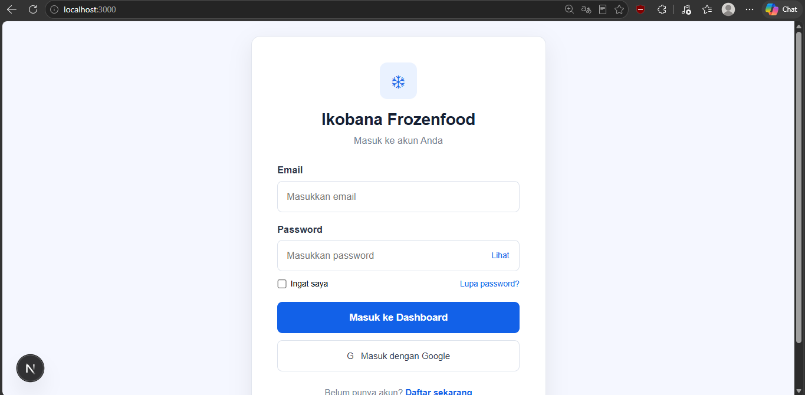
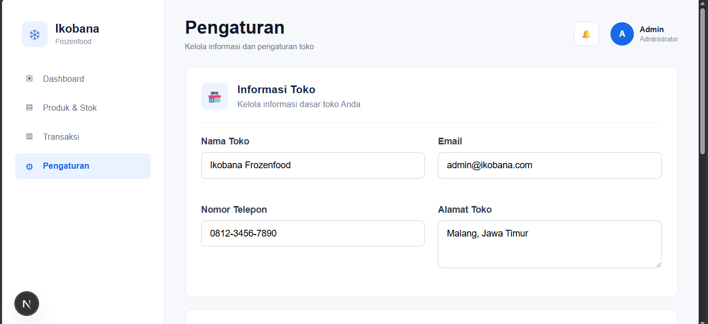
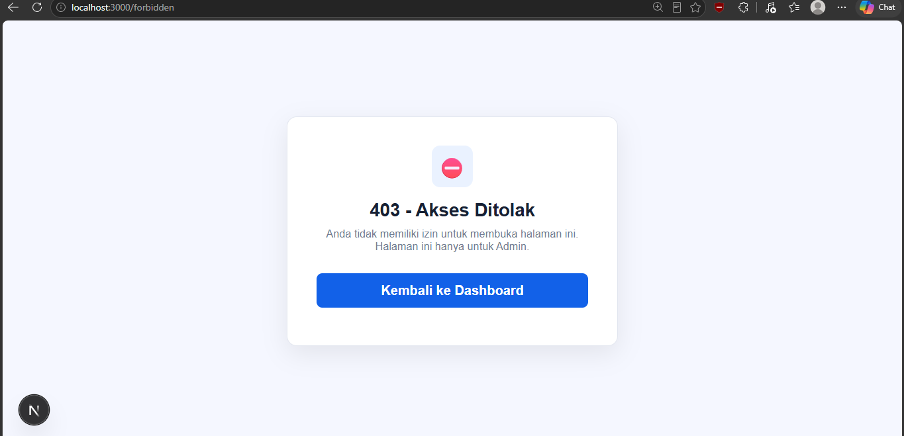

# Ikobana Frozen Food — Backend

Backend REST API untuk aplikasi manajemen toko **Ikobana Frozen Food** (Project-Based Learning).
Dokumen ini juga menjadi dokumentasi **Tugas #9 — Autentikasi & Otorisasi**.

- **Desain Figma (PBL UAS):** _<!-- TODO: tempel tautan Figma di sini -->_ `https://www.figma.com/...`
- **Frontend:** https://github.com/hxjbruh/ikobana-frontend (Next.js)

---

## Tech Stack

| Bagian | Teknologi |
|---|---|
| Backend | Java 17, Spring Boot 3.1, Spring Security, Spring Data JPA |
| Autentikasi | JSON Web Token (JWT, library `jjwt`) — stateless |
| Hash password | BCrypt (`BCryptPasswordEncoder`) |
| Database | PostgreSQL (profil `dev`) atau H2 in-memory (profil `h2`) |
| Dokumentasi API | Swagger UI (springdoc-openapi) |
| Frontend | Next.js 16, React 19 |

---

## Akun Dummy untuk Penilaian

Akun ini dibuat otomatis setiap kali backend dijalankan (lihat `IkobanaBakendApplication.java`).

| Role | Email | Password | Hak akses |
|---|---|---|---|
| **ADMIN** | `admin@ikobana.com` | `Admin@12345` | Semua fitur: kelola produk & stok, lihat semua transaksi, ubah status transaksi, laporan, pengaturan |
| **CUSTOMER** | `customer@ikobana.com` | `Customer@12345` | Lihat produk (read-only), buat & lihat transaksi miliknya sendiri |

> Akun baru yang didaftarkan lewat halaman **Register** selalu mendapat role **CUSTOMER**.
> Akun ADMIN tidak bisa dibuat lewat registrasi publik.

---

## Cara Menjalankan

**Cara termudah (Windows):** klik dua kali `jalankan-aplikasi.bat`. Script ini menjalankan backend (H2) + frontend lalu membuka browser ke http://localhost:3000.

**Manual:**

```bash
# Backend (tanpa PostgreSQL, data hilang saat dimatikan)
./mvnw clean package -DskipTests
java -jar target/ikobana-backend-0.0.1-SNAPSHOT.jar --spring.profiles.active=h2

# Frontend (di folder pbl-framework-frontend-main)
npm install
npm run dev
```

| Alamat | Keterangan |
|---|---|
| http://localhost:3000 | Aplikasi (frontend) |
| http://localhost:8080/api | REST API |
| http://localhost:8080/swagger-ui.html | Dokumentasi & uji coba API |

Untuk memakai PostgreSQL, jalankan tanpa `--spring.profiles.active=h2` dan sesuaikan `spring.datasource.*` di `application-dev.properties`.

---

## 1. Autentikasi (Auth Module)

> **Autentikasi** = memastikan *siapa* pengguna (memvalidasi identitas lewat email + password).
> **Otorisasi** = menentukan *apa saja* yang boleh dilakukan pengguna tersebut (berdasarkan role).

| Fitur | Endpoint API | Halaman UI |
|---|---|---|
| Registrasi | `POST /api/auth/register` | `/register` |
| Login | `POST /api/auth/login` | `/` |
| Profil pengguna login | `GET /api/auth/me` | sidebar / header |
| Logout | `POST /api/auth/logout` | tombol **Keluar** |

### Alur

```
Register / Login
  ├─ Backend memvalidasi input (Bean Validation)
  ├─ Register: password di-hash dengan BCrypt lalu disimpan, role dipaksa CUSTOMER
  ├─ Login: BCrypt.matches(password, hash) — password asli tidak pernah disimpan
  └─ Backend mengembalikan JWT (berisi userId, email, role; berlaku 1 jam di profil h2/dev)

Setiap request berikutnya
  └─ Frontend mengirim header  Authorization: Bearer <token>
       └─ JwtAuthenticationFilter: cek tanda tangan + masa berlaku + blacklist
            └─ valid → user dimasukkan ke SecurityContext (beserta role-nya)

Logout
  ├─ Frontend memanggil POST /api/auth/logout
  ├─ Backend memasukkan token ke blacklist (TokenBlacklist) sampai token kedaluwarsa
  │    → token lama langsung ditolak (401) walaupun belum expired
  └─ Frontend menghapus token & data user dari localStorage
```

### Manajemen Sesi: JWT

Backend bersifat **stateless** (`SessionCreationPolicy.STATELESS`) — tidak ada session di server.
Identitas pengguna dibawa di dalam JWT yang ditandatangani dengan secret key (HMAC). Logout
ditangani dengan **token blacklist** supaya token yang sudah logout tidak bisa dipakai ulang.

File terkait:
- `security/JwtTokenProvider.java` — membuat & memvalidasi token
- `security/JwtAuthenticationFilter.java` — membaca token di setiap request
- `security/TokenBlacklist.java` — daftar token yang sudah logout
- `service/AuthService.java`, `controller/AuthController.java` — logika register/login/logout

---

## 2. Keamanan (Security)

| Praktik | Implementasi |
|---|---|
| Password tidak disimpan plain text | Disimpan sebagai hash **BCrypt** di kolom `password_hash` (`SecurityConfig.passwordEncoder()`) |
| Pesan error login tidak membocorkan data | Email tidak terdaftar & password salah sama-sama menjawab **401 "Email atau password salah"**, jadi penyerang tidak bisa menebak email yang terdaftar |
| Tidak bisa mendaftar sebagai admin | Field `role` dihapus dari request registrasi; role selalu `CUSTOMER` |
| Error tidak membocorkan stack trace | `GlobalExceptionHandler` mengubah semua error menjadi JSON rapi (400/401/403/404/409/500) |
| Validasi input | Bean Validation (`@NotBlank`, `@Email`, `@Length`, password = konfirmasi password) |
| Token logout tidak bisa dipakai ulang | `TokenBlacklist` dicek di `JwtAuthenticationFilter` |

---

## 3. Otorisasi (Role-Based Access Control)

Role yang tersedia: **ADMIN** dan **CUSTOMER** (enum `UserRole` juga memiliki `RETAILER`, saat ini aksesnya sama dengan CUSTOMER).

### Level Server (API) — Spring Security

Diterapkan di dua lapis:
1. **URL rules** di `SecurityConfig.filterChain()` (`permitAll`, `authenticated`, `hasRole("ADMIN")`)
2. **Method security** dengan `@PreAuthorize` di controller

| Endpoint | Tanpa login | CUSTOMER | ADMIN |
|---|---|---|---|
| `POST /api/auth/register`, `POST /api/auth/login` | ✅ | ✅ | ✅ |
| `GET /api/auth/me`, `POST /api/auth/logout` | ❌ 401 | ✅ | ✅ |
| `GET /api/products`, `/api/products/{id}`, `/api/products/search` | ✅ | ✅ | ✅ |
| `GET /api/products/low-stock` | ❌ 401 | ❌ 403 | ✅ |
| `POST/PUT/DELETE /api/products/**` (kelola produk & stok) | ❌ 401 | ❌ 403 | ✅ |
| `POST /api/transactions`, `GET /api/transactions` (milik sendiri) | ❌ 401 | ✅ | ✅ |
| `GET /api/transactions/{id}` | ❌ 401 | ✅ hanya miliknya, lainnya 403 | ✅ |
| `GET /api/transactions/admin/**`, `/report/**` | ❌ 401 | ❌ 403 | ✅ |
| `PUT /api/transactions/{id}/payment-status`, `/delivery-status` | ❌ 401 | ❌ 403 | ✅ |

- **401 Unauthorized** = belum login / token tidak valid / token sudah logout
- **403 Forbidden** = sudah login, tetapi role tidak punya izin

### Level Antarmuka (UI) — Guard di Frontend

Fungsi `requireLogin(allowedRoles?)` di `app/lib/api.ts` dipanggil di awal setiap halaman:

| Halaman | Tanpa login | CUSTOMER | ADMIN |
|---|---|---|---|
| `/dashboard`, `/products`, `/transactions`, `/transactions/[id]` | redirect ke login | ✅ | ✅ |
| `/products/add`, `/products/edit/[id]`, `/settings` | redirect ke login | redirect ke **`/forbidden` (403)** | ✅ |
| Tombol Tambah/Edit/Hapus produk | — | disembunyikan | tampil |
| Form ubah status transaksi | — | disembunyikan | tampil |

Guard UI hanya untuk pengalaman pengguna; keamanan sebenarnya tetap di backend, sehingga
request langsung ke API tanpa izin tetap ditolak.

---

## 4. Dokumentasi Evaluasi Uji Coba

Uji coba otomatis ada di `test-api.ps1` (23 skenario):

```bash
powershell -ExecutionPolicy Bypass -File .\test-api.ps1
```

Hasil uji coba manual (16 Oktober 2026):

| No | Skenario | Hasil yang diharapkan | Hasil |
|---|---|---|---|
| 1 | Register dengan `"role":"ADMIN"` di body | Akun dibuat sebagai CUSTOMER | ✅ |
| 2 | Login email tidak terdaftar | 401 "Email atau password salah" | ✅ |
| 3 | Login password salah | 401 "Email atau password salah" (pesan sama) | ✅ |
| 4 | Login akun dummy ADMIN & CUSTOMER | 200 + token JWT | ✅ |
| 5 | `GET /products/low-stock` sebagai Admin / Customer / tanpa login | 200 / 403 / 401 | ✅ |
| 6 | `GET /transactions/admin/all` sebagai Admin / Customer / tanpa login | 200 / 403 / 401 | ✅ |
| 7 | `POST /products` sebagai Admin / Customer / tanpa login | 201 / 403 / 401 | ✅ |
| 8 | Pakai token lama setelah logout (`GET /auth/me`) | 401 | ✅ |
| 9 | Customer membuka `/products/add` dan `/settings` di browser | Diarahkan ke halaman 403 | ✅ |
| 10 | Customer membuka `/products` | Tombol Tambah/Edit/Hapus tidak tampil | ✅ |
| 11 | Membuka `/dashboard` tanpa login | Diarahkan ke halaman login | ✅ |
| 12 | Klik **Keluar** | Token dihapus dari browser & ditolak backend (401) | ✅ |

### Screenshot

**Halaman Login** (`/`)



**Halaman Pengaturan — dibuka oleh Admin** (`/settings`, diizinkan)



**Halaman yang sama dibuka oleh Customer** (`/settings` → `/forbidden`, ditolak 403)



<!-- TODO: tambahkan screenshot lain, misalnya dashboard admin & halaman produk -->
<!--  -->

---

## Struktur Folder Penting

```
src/main/java/com/ikobana/backend/
├── config/        SecurityConfig (aturan akses), GlobalExceptionHandler, OpenApiConfig
├── controller/    AuthController, ProductController, TransactionController
├── security/      JwtTokenProvider, JwtAuthenticationFilter, TokenBlacklist
├── service/       AuthService, ProductService, TransactionService
├── entity/        User, UserRole, Product, Transaction, ...
└── dto/           Request & response API
```
